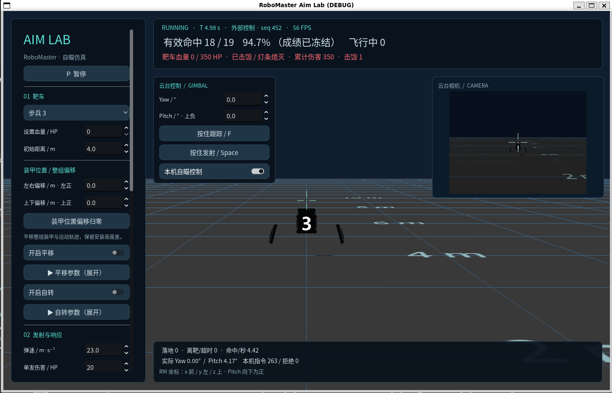
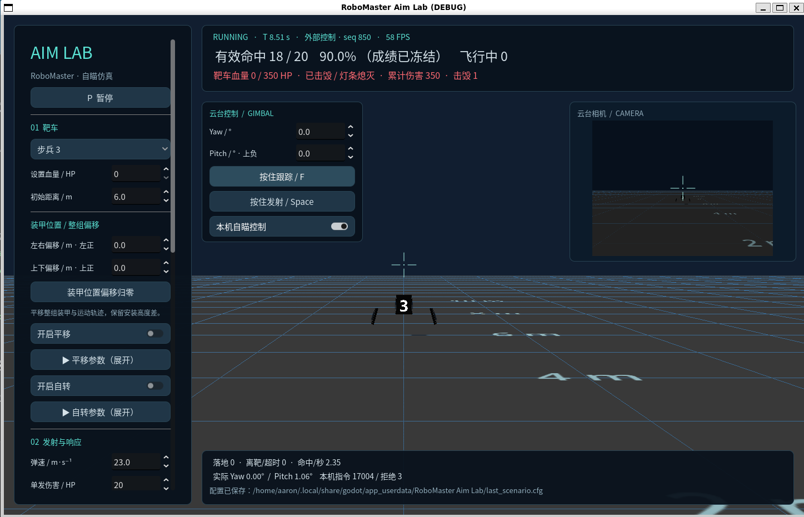
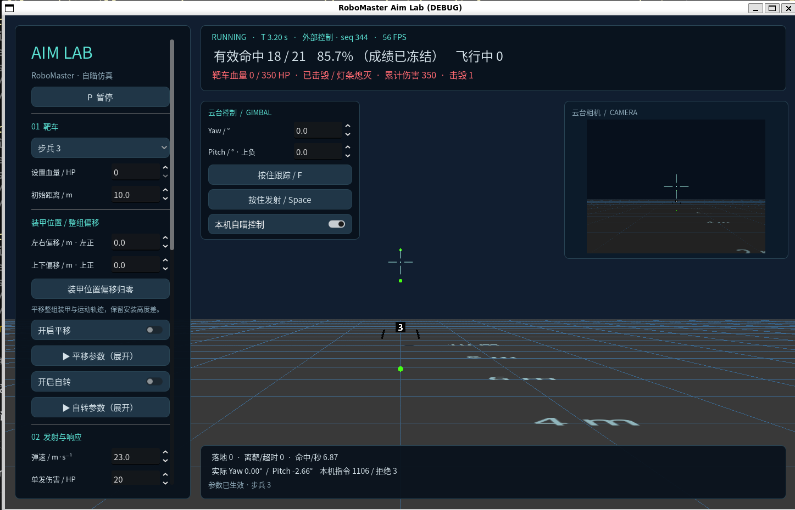
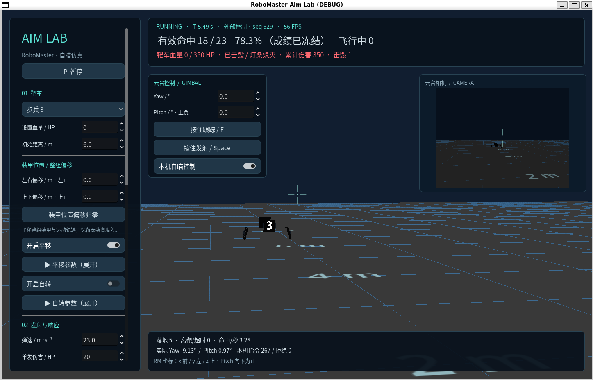
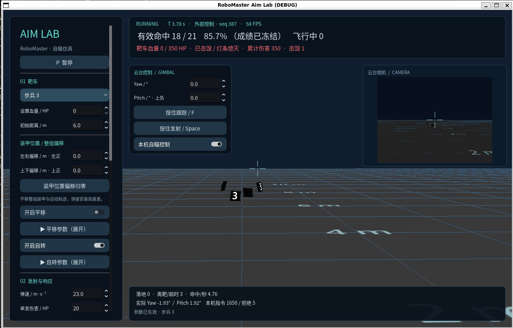
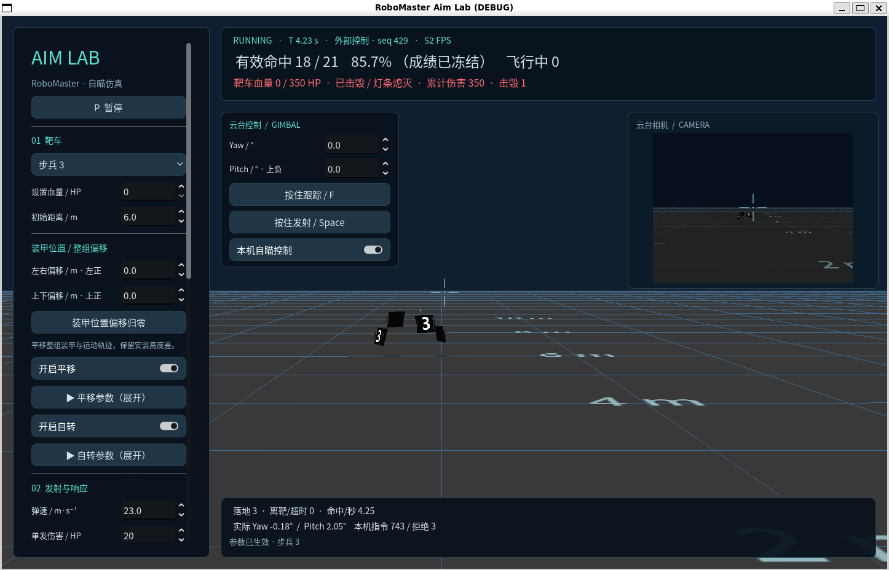

# 总成绩

六个场景全部击毁 350 HP 靶车，截图来自仿真界面右上角统计栏（成绩已冻结）。

| 任务 | 场景 | 有效命中 | 命中/发射 | 界面时刻 | 结果 | 截图 |
|---|---|---|---|---|---|---|
| 一 | 4 m 固定靶 | **94.7 %** | 18/19 | T 4.98 s | 击毁 | `screenshots/task01_4m.png` |
| 二 | 6 m 固定靶 | **90.0 %** | 18/20 | T 8.51 s | 击毁 | `screenshots/task02_6m.png` |
| 三 | 10 m 固定靶 | **85.7 %** | 18/21 | T 3.20 s | 击毁 | `screenshots/task03_10m.png` |
| 四 | 6 m 平移靶 | **78.3 %** | 18/23 | T 5.49 s | 击毁 | `screenshots/task04_6m_translate.png` |
| 五 | 6 m 旋转靶 | **85.7 %** | 18/21 | T 3.78 s | 击毁 | `screenshots/task05_6m_spin.png` |
| 六 | 6 m 平移旋转靶 | **85.7 %** | 18/21 | T 4.23 s | 击毁 | `screenshots/task06_6m_combined.png` |

口径：`有效命中 = valid_hits / fired`，击杀瞬间还在飞的子弹只进分母，所以固定靶到不了 100 %。靶车 350 HP、单发 20 HP，需 18 发有效命中。「界面时刻」是仿真启动到击杀的绝对时间，含预热，跨场景不宜直接比。

## 任务一 · 4 m 固定靶

## 任务二 · 6 m 固定靶

## 任务三 · 10 m 固定靶

10 m 处子弹下坠 0.89 m，仰角补偿后 pitch 由负转正（+2.66°）。

## 任务四 · 6 m 平移靶

## 任务五 · 6 m 旋转靶

## 任务六 · 6 m 平移旋转靶

